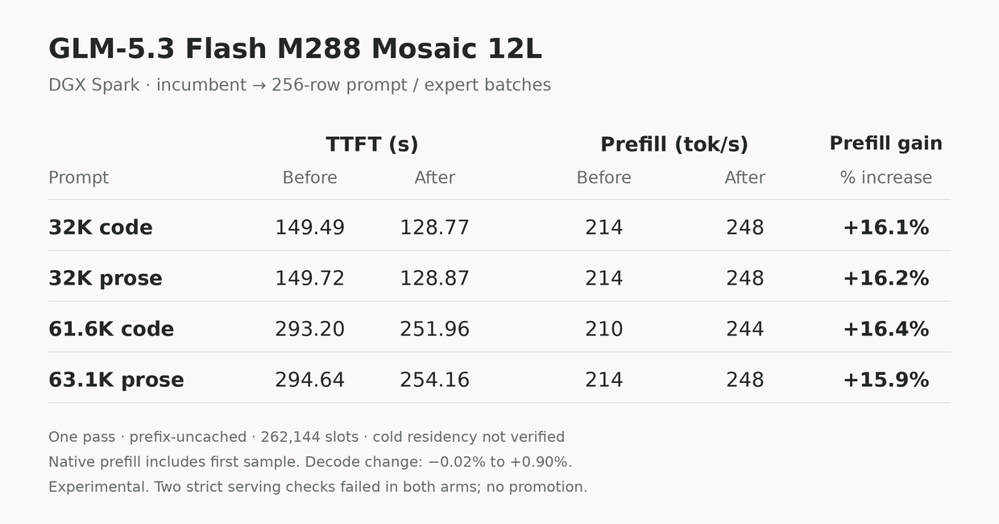

# Experimental prompt-only 256-row batching

On the current M288 Mosaic 12L checkpoint, one matched sweep improved 32K/~64K fresh-prefill proxy throughput by **15.93–16.37%**. All six decode cells were within the predeclared 3% provisionally-neutral screen, ranging from **−0.02% to +0.90%**. This is not proof of decode equivalence.



**Experimental, not the default recipe.** Full serving qualification is indeterminate. Two frozen smoke checks failed identically in both arms; they remain failed. The patch was not left deployed.

## Measured, not historical

The comparator is a fresh 128-row control of the retained Mosaic serving runtime, not the older published approximately 290 tok/s measurement. Both arms use 262,144 slots, the same mixed 2-bit/3-bit checkpoint, BF16 KV cache, tokenizer/template, sampler, depth-one MTP, vision, thinking guard, state reuse, JSON and streamed keep-alives. Short speed requests disable the thinking guard per request only; production defaults remain enabled.

| Prompt tokens | Domain | TTFT before → after | Prefill proxy before → after | Rate increase |
|---:|---|---:|---:|---:|
| 8,000 | Code | 38.27 → 35.20 s | 209.03 → 227.30 tok/s | +8.74% |
| 8,000 | Prose | 37.78 → 32.42 s | 211.76 → 246.80 tok/s | +16.55% |
| 32,000 | Code | 149.49 → 128.77 s | 214.07 → 248.50 tok/s | +16.09% |
| 32,000 | Prose | 149.72 → 128.87 s | 213.73 → 248.30 tok/s | +16.18% |
| 61,582 | Code | 293.20 → 251.96 s | 210.04 → 244.41 tok/s | +16.37% |
| 63,142 | Prose | 294.64 → 254.16 s | 214.30 → 248.44 tok/s | +15.93% |

Prefill rate is prompt tokens divided by native `prefill_s`, which **includes the first sample**. It is not isolated GPU prefill throughput. TTFT excludes empty keep-alives. Prefix reuse was bypassed consistently, and cached-token counts were zero. No page-cold residency was established. Long fixtures nominally called 64K actually rendered to 61,582 and 63,142 tokens.

### Every decode cell

Exactly 400 emitted tokens per request. Rates exclude the first callback; no surplus work was clipped. Raw receipts also retain TTFT, request-wall duration, complete output IDs, text and draft counters.

| Domain/context | Control | Treatment | Change |
|---|---:|---:|---:|
| Short code | 27.72 tok/s | 27.79 tok/s | +0.25% |
| Short math | 30.87 tok/s | 30.92 tok/s | +0.18% |
| Short prose | 28.22 tok/s | 28.33 tok/s | +0.39% |
| Short structured | 33.64 tok/s | 33.64 tok/s | −0.02% |
| 32K code | 29.45 tok/s | 29.71 tok/s | +0.90% |
| 63,142-token prose | 30.04 tok/s | 30.24 tok/s | +0.66% |

## What changed

A low-overhead 8K prompt profile attributed 52.1% of sampled top-level intervals to packed routed experts and 9.0% to packed plain projections. The real loader used 128-row prompt chunks; increasing expert scratch alone would therefore not help.

The selected treatment increases **prompt chunks and prompt-role expert scratch from 128 to 256 rows**. Packed dense staging stays at 128; serial decode and MTP verification stay on their original two-row buffers. It dispatches on the actual `Buffers.prefill` role, not row count, including one-row prompt and absorption calls. It changes no CUDA kernel code, codebook, fixed expert reduction plan, checkpoint bytes or stored precision.

The patch builds on [TensorFold v0.6.5](https://github.com/ashhart/TensorFold/tree/609ca419abecebdc5a059498a613680bd3aa847f), [ExLlamaV3](https://github.com/turboderp/exllamav3) packed expert kernels, and this repository's single-GPU port. This is **not PR212** or a transplanted FlashNext prompt kernel.

## Optional source integration

Apply the existing four recipe patches first. From the TensorFold checkout:

```bash
git apply --check --whitespace=error-all /path/to/glm53-flash-single-gb10/patches/05-experimental-prompt256.patch
git apply /path/to/glm53-flash-single-gb10/patches/05-experimental-prompt256.patch
```

Patch SHA-256: `b310ab10d9f025809fa5501513e027b75d129a7b40f953451860026fba78df4c`.

The host-specific serving loader remains unpublished, as in the main recipe. The public patch covers only portable TensorFold changes. In a compatible loader, import the policy and use the **same selected prompt-row value for admission and Engine allocation**:

```python
from tensorfold.families.glm5_next.cuda.prompt_policy import prompt_rows

p_rows = prompt_rows()
extra = weights.workspace_bytes(cfg, headers, rows=2,
                                prefill_rows=p_rows, load_mtp=True)
engine = decode.Engine(weights_loaded, capacity=262144, max_rows=2,
                       prefill_rows=p_rows, graphs=False, long_context=True)
```

This snippet shows the two exercised substitutions, not a standalone launcher. Keep the loader's existing model, admission, vision, sampling and state-handling contracts. Set `GLM_PROMPT_WIDE=0` for control, `GLM_PROMPT_WIDE=1` for treatment **before loading**, and do not mutate it in a loaded process. Leaving it unset preserves the 128-row policy. Increasing expert scratch without increasing prompt chunks does not reproduce this treatment. Do not reduce context to fit.

CPU policy/source checks, without loading Torch or a model:

```bash
python3 /path/to/glm53-flash-single-gb10/experiments/prompt256/test_policy.py \
  --runtime /path/to/TensorFold
```

## Correctness, gates and limits

- 21/21 actual-checkpoint old-window/new-window module cases were bit-exact: 2-bit, 3-bit and mixed banks, shared-expert combine, row boundaries 1, 127, 128, 129, 255, 256 and 257.
- 20/20 primary output streams matched across arms. Same-runtime 48-token serial/MTP witnesses matched in four domains per arm. Draft counters matched in every decode cell.
- All six feature responses completed and matched in content, reasoning and token IDs. JSON, native vision, state priming and state resume passed.
- A strict READY-only check failed because content included deliberation before READY. A thinking-enabled arithmetic task answered correctly and closed reasoning, but failed a nonempty-reasoning requirement. **Both failures occurred identically in control and treatment.** The frozen scores were not relaxed.
- Changing prompt chunk shape may affect attention/KDA arithmetic beyond this bounded panel. Do not describe the patch as universally lossless.

There was one primary sweep per arm, 20 requests each, and no optional second candidate or repeats. A test-harness defect selected a dense layer as an expert fixture before B collected any primary rows. The failing attempt was preserved, the selector corrected to actual loaded expert widths, and uncollected B ran in a **second supervised maintenance window**. Control A was retained; the original fixed swap baseline was not reset. This is a protocol deviation, not an uninterrupted A/B block. The first 8K control request followed a diagnostic profile; the 32K/~64K cells followed the same planned order in both arms.

Minimum host reserve was **7.384 GiB**, above the 7 GiB floor. Maximum host-swap growth was **3.926 MiB**, below the 1 GiB allowance. Experiment-cgroup swap was disabled and stayed at zero. No hard safety abort occurred. The displaced deployment was restored with unchanged image, source and configuration, a completed authenticated response and compact vision/state-reuse checks.

**Verdict:** positive performance screen, indeterminate full qualification. Keep as an experimental patch, not an automatically promoted recipe.

## Receipts

- [Summary, all paired cells, identities, module gates and safety](../../results/glm53-mosaic-prefill-prompt256-20261012.json)
- [Observed per-arm timings, full emitted IDs, outputs, draft counters and feature responses](../../results/glm53-mosaic-prefill-prompt256-20261012-runs.json)
- [Card values, dimensions and checksum](../../results/glm53-mosaic-prefill-prompt256-card.json)
- [Optional source patch](../../patches/05-experimental-prompt256.patch)

The public receipts retain fixture fingerprints rather than the host's large rendered prompt arrays or its orchestration code. No model weights are redistributed.
